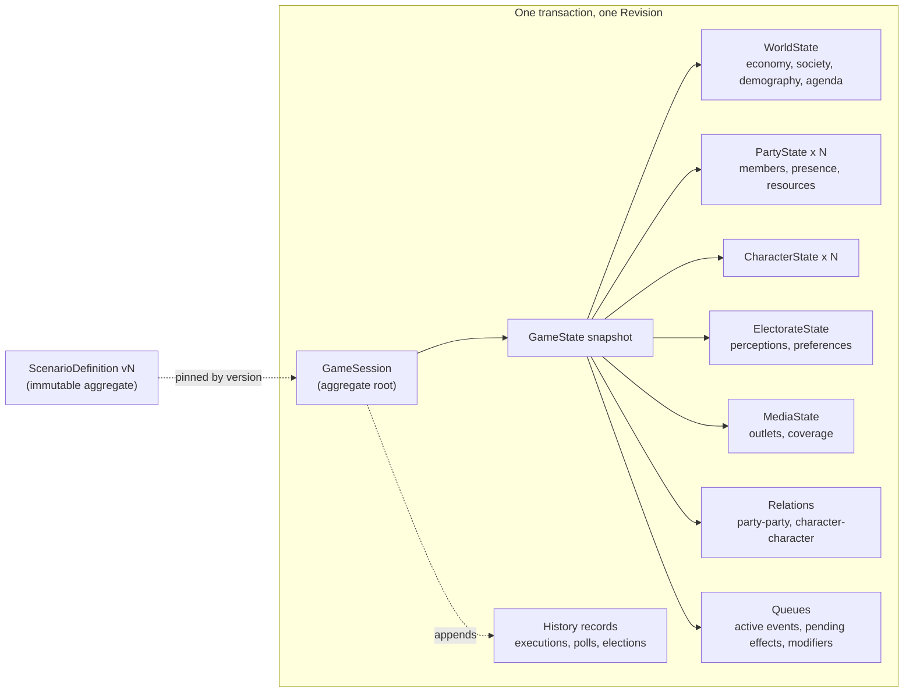
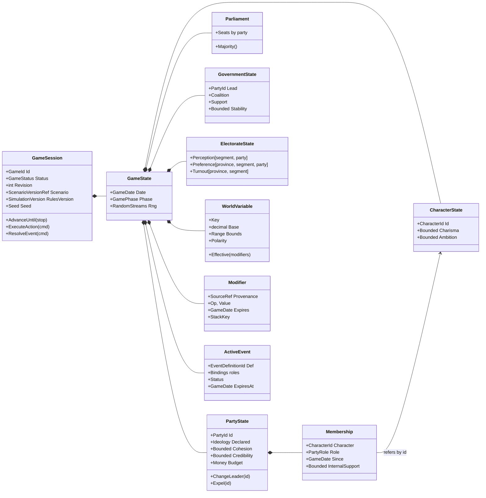
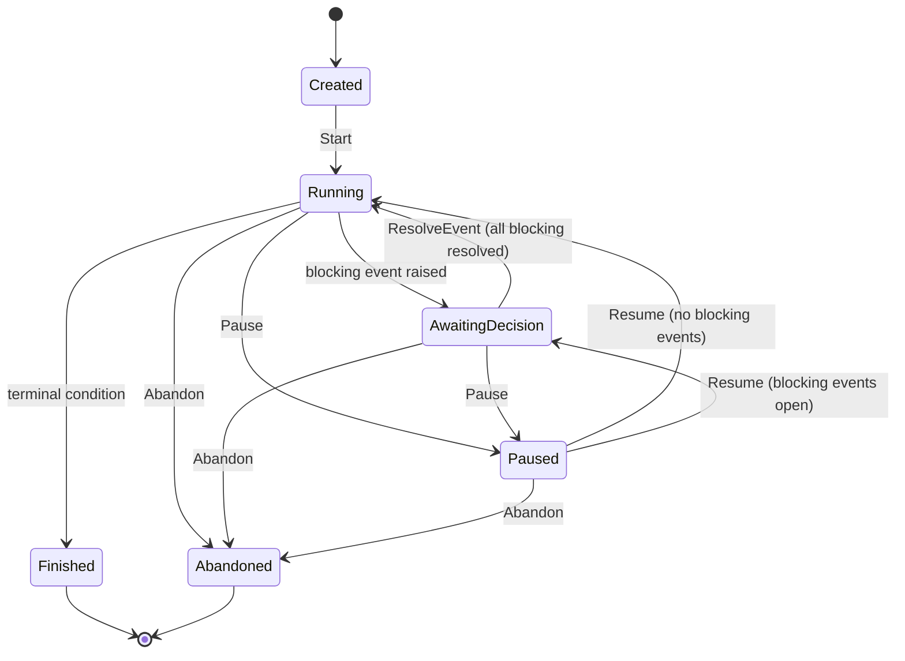
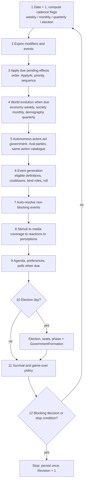
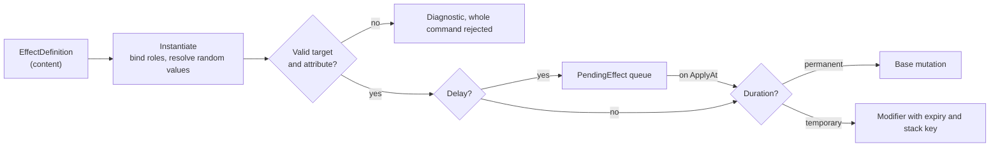

# Political Simulator — Domain Design Review

Nov 4, 2026 · @Victor Lendínez Agudo

## Summary

The spec (v0.1) is unusually strong on principles — emergent votes, data-driven content, determinism, thin Application layer — but it is weaker on the mechanics that make those principles workable. Five decisions should be settled before any code is written.

1. **The whole simulated world is one consistency boundary.** A daily tick and every effect can touch parties, characters, perceptions and variables at once, under one revision. Model a `GameSession` aggregate (game header + `GameState` snapshot) and enforce local invariants inside state components, rather than making `PoliticalParty` a separately persisted aggregate.
2. **Content must not write perceptions directly.** If an event can say "segment X trust in party Y −10", authors are hand-placing votes. Actions and events should emit *stimuli* (issue, stance, intensity, actor); a reaction pipeline turns them into per-segment perception changes.
3. **Temporary effects need a modifier layer.** Reverting a clamped `Add` on expiry is not exact. Separate base values (permanent changes) from active modifiers (temporary changes), and compute the effective value on read.
4. **Event definitions need role bindings.** A reusable "corruption scandal" needs a slot for *which* party and *which* character, filled when the event fires. The spec's `Condition` and `EffectDefinition` have no way to refer to them.
5. **The calendar needs a decision-point model.** 1,461 days per legislature cannot be advanced one click at a time. Add `AdvanceUntil` (next decision, date, or N days) and an explicit `AwaitingDecision` state.

The largest scope risk: the MVP list requires parliamentary votes, government formation and an autonomous world, while rival-party AI, parliamentary detail and government attribution are all listed as open decisions. Each needs at least a minimal default (proposed under Open decisions).

## Aggregate boundaries

An aggregate is a transactional consistency boundary. The spec persists one `GameState` snapshot under one `Revision`, and requires every action and tick to be atomic across parties, characters, variables and perceptions. That makes the running world a single consistency boundary, whatever the class names say. Splitting `PoliticalParty` into its own repository would force cross-aggregate transactions on every tick, which is exactly what aggregates exist to avoid.

The spec's real worry — one giant `Game` class with every rule in it — is solved by *internal* modularity, not by more aggregates.

| Unit | Kind | Owns | Persisted as |
| --- | --- | --- | --- |
| `GameSession` | Aggregate root | Lifecycle, status, phase, revision, versions, seed, owner | Relational row |
| `GameState` | Part of `GameSession`, loaded with it | All mutable simulation state; date lives here only | One JSONB snapshot |
| `PartyState`, `CharacterState`, `ElectorateState`, `MediaState`, `WorldState` | State components (entity-like, not aggregates) | Their own invariants: bounds, membership, leadership | Inside the snapshot |
| `ScenarioDefinition` | Separate aggregate, immutable once published | Catalogues, initial values, parameters, electoral law | Versioned rows / JSON |
| `ElectionRecord`, `PollRecord`, `ExecutionRecord` | Append-only history | Facts that never change after creation | Relational, insert-only |

Rules that follow from this:

- Only `GameSession` exposes commands (`AdvanceUntil`, `ExecuteAction`, `ResolveEvent`, `Pause`, `Abandon`). Components expose intention-revealing methods (`party.ChangeLeader(...)`) that the session or a domain service calls.
- `Game.CurrentDate` and `GameState.CurrentDate` must not both exist. Keep the date in `GameState`; project it onto the relational row for queries.
- A game pins a *published scenario version*, not a scenario id. Editing a scenario must never change running games.
- History records are written in the same transaction as the snapshot, but they are never read back to compute the next state. The snapshot alone must be enough to resume.



## Domain module map

Eight modules inside one Domain project, each owning its state and its pure calculators. Dependencies point inward to `Common` and `Content`; no module references the Application layer.

| Module | Owns (state) | Pure services | Missing from the spec |
| --- | --- | --- | --- |
| Common | `GameDate`, typed ids, `Bounded<T>`, `IRandomSource`, `Result` | Calendar arithmetic, week/month/quarter boundaries | Bounded numeric type; deterministic calendar rules |
| Content | Definitions: events, actions, conditions, effects, issues, scenario | Content validator, condition evaluator | **Issue catalogue**; role bindings; value-expression grammar |
| World | Variables, provinces, composition, public agenda | Variable evolution, agenda calculator | Issue ↔ variable links (what "the economy" means to voters) |
| Politics | Parties, memberships, presence, relations, government, parliament | Government formation, survival policy | **Parliament** (seats as source of truth), bills, candidacies per constituency |
| Actors | Characters, character relations | Reaction calculator (internal) | Per-segment leader perception |
| Media | Outlets, coverage facts, house effects of pollsters | Coverage calculator | Outlet memory (past framing) |
| Electorate | Segments, perceptions, preferences, polls, elections | Affinity, utility, turnout, preference, provincial vote, D'Hondt | Provincial ideology offsets per segment |
| Simulation | Tick pipeline, effect engine, modifier store, queues | `SimulationEngine`, `EffectEngine`, `EventScheduler` | Decision-point model; stimulus pipeline |



Two naming changes are worth making early. `Party.Seats` becomes a `Parliament` component, because seats are an election outcome, not a party attribute. `PartyMembership.Loyalty` becomes `InternalSupport`, so it is not confused with `PoliticalCharacter.Loyalty` (a personality trait).

## Causal chain: from decision to seats

The spec forbids actions from awarding votes, but it also lists "a population segment's perception of a party" as a valid effect target. Perception feeds utility almost linearly, so a content author writing "trust −15 among retirees" is placing votes by hand. That also defeats heterogeneous reactions: the author, not the model, decides who reacts.

The fix is one extra stage. Actions and events emit **stimuli**, and only the reaction pipeline writes perceptions.

&#91;embedded content: decision-to-seats pipeline · 8 stages, 2 side inputs\]

Everything below the top box is computed; only the top box is authored. The dashed box is the only part the player sees directly.

A stimulus is a small typed record:

| Field | Example | Used by |
| --- | --- | --- |
| `Actor` | Player party, or the party bound to role `accused` | Who is judged |
| `Issue` | `corruption`, `pensions`, `housing` | Agenda salience, segment sensitivity |
| `Kind` | Positional (takes a stance) or valence (competence, scandal) | Whether ideology matters |
| `Stance` | Position on the issue's axis, −100 to +100 | Ideological fit (positional only) |
| `Intensity` | 0–1 | Magnitude before filtering |
| `Visibility` | Public, parliamentary, internal | Media pick-up probability |

This keeps the authoring surface small ("the party took a hard pro-pension stance, intensity 0.7") and makes the six segments react differently without any author writing six numbers.

Effect targets then split into two groups. Content may write world variables, party and character attributes, relations, agenda topics, resources and presence directly. Content may **not** write perceptions, preferences, turnout or seats; those are reachable only through stimuli. A scenario-level escape hatch (for a scripted opening shock) can exist, but it should be flagged and rejected by the default content validator.

## Simulation loop and pause model

The player should never advance one day at a time. A legislature is 1,461 days; at one click per day that is unplayable, and one snapshot write per day is wasteful. Replace `AdvanceGameDay` with `AdvanceUntil(stop, maxDays)`, run the days in memory, and persist once per command with one revision increment.

Stop conditions: a blocking event needs a decision, an election or phase change is reached, the game ends, or `maxDays` passes. The spec's step 7 ("execute submitted player action") sits inside the day loop; it should not. Player actions are separate commands that run *between* days.

### Game status

`Paused` (the player chose to stop) and `AwaitingDecision` (the simulation cannot continue) are different states and must not share a value. `GamePhase` (normal, campaign, election day, government formation) is orthogonal to status.



Voluntary actions are allowed in `Running` and `AwaitingDecision` (answering a scandal with a press conference is a voluntary action). They are refused in `Created`, `Paused`, `Finished` and `Abandoned`.

### Order inside one day

The spec applies pending effects before expiring old ones. Expiring first is safer: an effect with `RefreshDuration` that is reapplied on its expiry day then stays alive. Every loop below iterates in a stable order (by id), never in dictionary order.



Player action timing: an action executes on the current date after that day's tick. Its immediate effects apply at once; its stimuli are queued and processed in step 8 of the next day, so media and reactions always run in one place.

Two cadence details to fix in the spec: "weekly" needs a definition (ISO Monday or every 7 days from game start), and "recalculate preferences when relevant" needs one rule (weekly is enough; preferences are not visible daily anyway).

## Effect engine design

Temporary effects should never be undone by subtraction. Take inflation at 9.5 with a ceiling of 10: a temporary +2 is clamped to +0.5, and "reverting" it on expiry subtracts 2, leaving 8 instead of 9.5. Stacking, multiplication and bounds make reversal wrong in general.

The fix is two layers per numeric attribute:

- **Base value** — changed only by permanent effects and by natural evolution. Clamped on write.
- **Active modifiers** — temporary effects, each with source, expiry and stack key. Never folded into the base.
- **Effective value** — computed on read: base, then `Set` overrides, then additions, then multipliers, then clamp. This order is fixed and documented, because `Add` and `Multiply` do not commute.

Expiry just removes the modifier. Clamping becomes a reportable diagnostic ("effect truncated by 1.5 at upper bound") instead of silent loss.

| Behaviour in spec | Mechanism |
| --- | --- |
| Immediate, permanent | Base mutation now |
| Immediate, temporary | Modifier now, with expiry |
| Delayed | `PendingEffect` that becomes one of the above on its date |
| Gradual / recurring | Recurring `PendingEffect` with a step value and a count, or a temporary change to the variable's target or evolution rate |
| Trajectory change | Modifier on `TargetValue` or `EvolutionRate`, not on `CurrentValue` |



### Role bindings

Thirty reusable events need variables. A definition declares **roles** with selection rules; the occurrence stores the bound ids; conditions, effects, text templates and stimuli refer to roles, never to literal ids.

| Role | Selection rule (data) | Bound at |
| --- | --- | --- |
| `$accused` | A party with credibility below 60 | Trigger, random among candidates on the events stream |
| `$figure` | A member of `$accused` with role Leader or Spokesperson | Trigger |
| `$player`, `$government.lead`, `$self` | Built-in references | Always available |

If a required role has no candidate, the event is not eligible. That rule replaces many hand-written conditions.

### Rules for the engine

- **Attribute registry.** One code-side whitelist maps each `(target type, attribute key)` to its type, bounds and allowed operations. Conditions and effects are validated against it at content load; an unknown key fails validation.
- **Resolve randomness at instantiation.** A "+1 to +3" value is rolled when the effect is created and stored on the pending effect. Saved games then explain themselves, and reloading cannot reroll.
- **Default stack key** is `(source definition, effect index, target, attribute)`. Policy (`Stack`, `RefreshDuration`, `Replace`, `IgnoreDuplicate`) is per effect, with `RefreshDuration` as the default.
- **Atomicity through a change set.** Effects first produce a list of proposed changes; the engine validates all of them, then applies all of them. A failure anywhere rejects the command with nothing written.
- **Provenance on every change.** Each base mutation and modifier carries its source (execution or occurrence id, effect index) and an `external` / `policy` tag. Explanations ("why did my support fall?") and government attribution both read this tag.

## Electoral model review

The formulas in section 7 are a sound skeleton, but four of them conflict with each other or with Spanish reality. Each needs a decision before the calculators are written.

**1. Issues and axes are two different weight vectors.** The affinity formula uses `weight(s, axis)` over six axes; `IssueSensitivity` weights `IssueType`. The spec never defines issues or how they relate to axes. Define an **issue catalogue**: each issue is either *positional* (loads onto one or more axes; pensions → economy) or *valence* (no stance, only competence or blame; corruption, unemployment). Segments then carry both an axis-weight vector and an issue-weight vector.

**2. Affinity must not be counted twice.** Compute ideological fit from the party's *perceived* position, not store it again in the perception record. Keep perception as trust and respect plus one `PositionDrift` per segment-party pair (seen as more extreme or more moderate than declared). Utility reads the fit once.

**3. Abstention appears twice.** Section 7.4 puts abstention in the softmax and also computes turnout separately. Pick one. Recommended: turnout decides *whether* a segment votes; the softmax decides *whom*, over the parties standing in that constituency plus blank vote. "Undecided" is a poll concept and never appears in the hidden state.

**4. Inertia is time-step dependent.** If `lambda` is applied on every recalculation, changing the cadence from weekly to daily changes the whole game. Express volatility per 30 days and convert:

```latex
\lambda_{\Delta t} = 1 - (1 - \lambda_{30})^{\Delta t / 30}
```

### Scales and calibration

Centre every utility component to `[-1, 1]` before weighting (a 0–100 value `x` becomes `(x − 50) / 50`), with segment weights summing to 1. Temperature then has an interpretable range (roughly 0.1–0.3). Two calibration tests should be written before any content: identical parties get identical shares, and a 0.1 utility advantage produces a documented share gain.

```latex
U_{s,k}(p) = \sum_c w_{s,c}\,\hat{x}_c(s,k,p), \qquad \Pr(p \mid s,k) = \frac{e^{(U(p) - U_{max})/T_s}}{\sum_{j \in \text{standing}(k)} e^{(U(j) - U_{max})/T_s}}
```

### Spanish rules the spec simplifies

| Rule | Spec | Real Congress rule (put in `ElectoralSystem` config) |
| --- | --- | --- |
| Seat distribution | Configurable | 2 seats minimum per province, 1 each for Ceuta and Melilla, the rest by population (largest remainder) |
| Threshold base | 3% | 3% of *valid* votes in the constituency, which includes blank votes |
| D'Hondt ties | "Tie handling" | Party with more total votes wins the tie; then by lot, which needs the seeded random source |
| Candidacies | Not modelled | A party stands only in some constituencies; regional parties must be possible |

### Regional realism

With six national segments and identical segment ideology everywhere, provinces differ only by composition. That cannot produce Basque, Catalan or Canarian regionalist vote, which decides governments in this electoral system. The minimum fix is a per-province ideology offset for each segment (at least on the territory axis), plus per-constituency candidacies.

### Polls

Generate polls from turnout-weighted hidden preferences, with sampling noise from the sample size (standard error √(p(1 − p) / n)) and a persistent house effect per pollster. House effects must live in state so they stay stable across months.

## Determinism, numerics and persistence

The determinism goal is achievable, but three spec instructions undermine it as written: one global random sequence, "`decimal` everywhere", and an unspecified link between rules versions and saved games.

### Random streams

With one sequence, adding a single random call in the media model shifts every later event roll. Any content tweak or bug fix then changes the whole game, and replay tests break for unrelated reasons.

- Use a **counter-based** generator in the Domain: each draw is a hash of `(seed, stream, game day, index)`. No platform `Random`; its seeded algorithm is an implementation detail of .NET.
- One named stream per subsystem: `events`, `bindings`, `media`, `reactions`, `actors`, `polls`, `ties`.
- Persist only the seed and each stream's index for the current day. Resuming is then exact, and subsystems cannot disturb each other.
- Iterate collections in id order everywhere. Dictionary and hash-set enumeration order is not a contract.

### Decimal versus double

`decimal` has no `Exp`, `Log` or `Sqrt`. Softmax, a sigmoid turnout curve and poll noise all need them. Recommended policy: `decimal` for stored state, money and bounded attributes; `double` inside the electoral calculators; round results back to `decimal` at a fixed precision (for example 6 places) at the calculator boundary. Bit-exact `Math.Exp` across CPUs and runtime versions is not guaranteed, so a determinism test should run in CI on the deployment platform.

### Versions

| Version | Changes when | Policy |
| --- | --- | --- |
| `StateVersion` | Snapshot JSON shape changes | Chain of upcasters (v1 → v2 → v3) run on load |
| `SimulationVersion` | Any rule or formula changes | Replay equality is guaranteed only within one version; on upgrade, the game moves forward and history records the date |
| Scenario version | Content is edited | Games pin a published version; edits never reach running games |

Keeping every old rule set alive to replay old games is unrealistic for a small team. The table above makes that trade-off explicit instead of implied.

### Storage

- **Current snapshot** (JSONB) plus relational header: status, date, revision, versions, owner.
- **Command log**, append-only: command type, parameters, client command id (unique per game, which gives idempotency), resulting revision. With the seed and scenario version, this log replays the whole game. That turns any player bug report into a reproducible test.
- **Monthly snapshots** for history charts and fast replay from a midpoint.
- **History records** (polls, elections, executions with provenance) for the read side.

### Hidden information

The spec's `GetGameState` query should not exist for the client. Anything sent to the browser can be read by the player. Define a `PlayerView` projection (polls, visible indicators with noise, news, available actions), and keep the true state behind it.

## Weaknesses and inconsistencies

Twenty-four issues, seven of them high severity. High means the spec as written leads to a design that must be reworked; low means a naming or clarity fix.

| # | Issue | Severity | Fix |
| --- | --- | --- | --- |
| 1 | `PoliticalParty` as its own aggregate contradicts one snapshot, one revision and atomic ticks | High | One `GameSession` aggregate with internal state components (Aggregate boundaries) |
| 2 | Effects may target segment perceptions, letting content place votes by hand | High | Stimulus pipeline; perceptions reachable only through reactions (Causal chain) |
| 3 | Events have no role bindings, so definitions cannot say *which* party or character | High | Roles with selection rules, bound at trigger (Effect engine) |
| 4 | Expiry of a temporary effect is undefined; subtraction is wrong after clamping | High | Base value plus modifier layer (Effect engine) |
| 5 | Abstention is in the softmax *and* in a separate turnout model | High | Turnout decides whether; softmax decides whom (Electoral model) |
| 6 | MVP needs parliamentary votes and government formation; rival AI, parliament and attribution are open | High | Minimal defaults (Open decisions) |
| 7 | Identical segment ideology in every province rules out regionalist parties | High | Per-province ideology offsets; per-constituency candidacies |
| 8 | Duplicated truth: game date (twice), `Party.Seats`, `Party.LeaderId` vs membership role, `Character.PartyId` vs membership | Medium | One owner each; derive the rest |
| 9 | `PartyMembership.JoinedAt` is a wall-clock `DateTimeOffset` | Medium | `GameDate` for every in-game time |
| 10 | One global random sequence: any new draw changes every later outcome | Medium | Counter-based streams per subsystem |
| 11 | "`decimal` everywhere" but softmax needs `Exp` | Medium | `double` inside calculators, rounded at the boundary |
| 12 | Inertia `lambda` depends on how often preferences are recalculated | Medium | Volatility per 30 days, converted per step |
| 13 | `IssueType` is used but never defined; its link to the six axes is missing | Medium | Issue catalogue: positional or valence |
| 14 | Advancing one day per command is unplayable and writes 1,461 snapshots per legislature | Medium | `AdvanceUntil`, one write per command |
| 15 | Games reference a scenario id, so editing content changes running games | Medium | Pin a published scenario version |
| 16 | Unlimited voluntary actions per day until the action economy exists | Medium | Cooldowns plus a simple weekly action allowance |
| 17 | `GetGameState` would send hidden state to the browser | Medium | `PlayerView` projection only |
| 18 | Government performance is a utility input, but attribution is open and effects carry no origin tag | Medium | `external` / `policy` tag on every change |
| 19 | Character popularity is one national number; leader evaluation is needed per segment | Low | Derive per segment from popularity, charisma and fit |
| 20 | "2–4 dominant agenda topics" reads like an invariant | Low | Make it emergent: normalised relevance with decay, not a hard cap |
| 21 | Project tree lists `PublicPositionAction` etc., against "no class per action" | Low | Allowed as one handler per *category*; data per instance |
| 22 | `StateVersion` sits next to `Revision` and reads like concurrency | Low | Rename to `SchemaVersion` |
| 23 | "Party disappearance" has no edge cases: zero seats, merger, leaderless party | Low | List them in the survival policy |
| 24 | Tests cover rules but not balance | Low | Seed sweeps: run 200 seeds, assert outcome distributions stay in bands |

## Open decisions with proposed MVP defaults

The spec's twelve open decisions plus three new ones. Each default is the simplest rule that unblocks the MVP; every number is a placeholder for a configuration value, not a design claim.

| # | Decision | Blocks | Proposed MVP default |
| --- | --- | --- | --- |
| 1 | Party survival | Game over | Dissolution if, at a month end, any of: budget negative for 6 straight months, cohesion below 15, no seat in 2 straight general elections |
| 2 | Rival party AI | World autonomy, votes | Phase 1: rival behaviour as events whose `$actor` role binds a rival (no AI code). Phase 2: a weekly utility pick from the same action catalogue |
| 3 | Government attribution | Utility input | Per-indicator share (for example inflation 0.5, employment 0.6) of changes since the government began; changes tagged `external` get a third of that share |
| 4 | Action economy | Action spam | Budget plus a weekly allowance of voluntary actions plus per-definition cooldowns |
| 5 | Campaign mechanics | Phase handling | A 15-day campaign phase (the legal Spanish length): higher volatility and media attention, no special actions yet |
| 6 | Parliamentary detail | Votes, formation | Bills arrive as events from the government. Each party votes by rule (government parties yes; others by ideological distance and trust). Investiture: absolute majority (176) in the first vote, simple majority in the second; if none within 2 months, repeat election |
| 7 | Election law | Seats | Per-scenario `ElectoralSystem` config (see Electoral model) |
| 8 | Perception decay | Memory | Exponential decay toward the structural baseline, one half-life per dimension (trust slower than respect) |
| 9 | Media model | Reactions | Pick-up chance from newsworthiness × issue interest × sensationalism; tone from editorial alignment with the actor plus noise; impact = reach × credibility × segment media sensitivity × tone |
| 10 | Variable calibration | Balance | Placeholder values; seed-sweep tests decide |
| 11 | Content authoring | Content | JSON files in the repository, validated against a JSON schema and the attribute registry at startup and in CI |
| 12 | Pause model | Loop | Events flagged `blocking` or not; non-blocking events auto-resolve with their default option at expiry |
| 13 | Issue catalogue (new) | Reactions, affinity | About 12 issues, each positional (axis loadings) or valence (linked variables) |
| 14 | Visibility rules (new) | Player view | Per indicator: exact, noisy, delayed, or hidden |
| 15 | Early elections (new) | Calendar | MVP: fixed 4-year date plus forced repeat after a failed investiture; voluntary dissolution later |

## Recommended build order

Nine slices, each ending in something testable. Slice 5 has no dependencies beyond slice 0 and can run in parallel from the start; it holds the most formula risk.

1. **Foundations** — `GameDate` and calendar boundaries, `Bounded<T>`, typed ids, counter-based random streams. Done when the same seed and stream produce the same draws across processes.
2. **Session and loop** — `GameSession`, status machine, `AdvanceUntil` over an empty world, snapshot save and load. Done when a game advances 1,461 days, reloads mid-way, and finishes identical.
3. **Variables and effect engine** — base values, modifiers, pending effects, stacking, change-set atomicity, provenance. Done when the effect test list in spec section 15.2 passes.
4. **Content and events** — JSON loader, schema and attribute-registry validation, roles, cooldowns, blocking events, `AwaitingDecision`. Done when an invalid attribute fails at load and a scandal binds a party and a character.
5. **Electoral calculators (pure)** — affinity, utility, softmax, turnout, provincial aggregation, seat distribution, D'Hondt with ties. Done when the calibration tests and a hand-checked D'Hondt case pass.
6. **Actions** — the three categories as handlers, costs, allowance, cooldowns. Done when a failed action leaves the snapshot byte-identical.
7. **Stimulus pipeline** — media coverage, segment reactions, perception updates, agenda. Done when one stimulus moves six segments by different amounts.
8. **Polls, elections, parliament** — monthly polls with house effects, election day, investiture, government formation. Done when a full legislature produces a government.
9. **Survival, player view, balance** — survival policy, game over, `PlayerView` projection, seed sweeps. Done when 200 seeds produce outcome distributions inside agreed bands.

The spec's milestone ("aggregate diagram plus unresolved decisions") is covered by the Aggregate boundaries, Domain module map and Open decisions sections. Those three are the review package to agree on before slice 1 starts.
